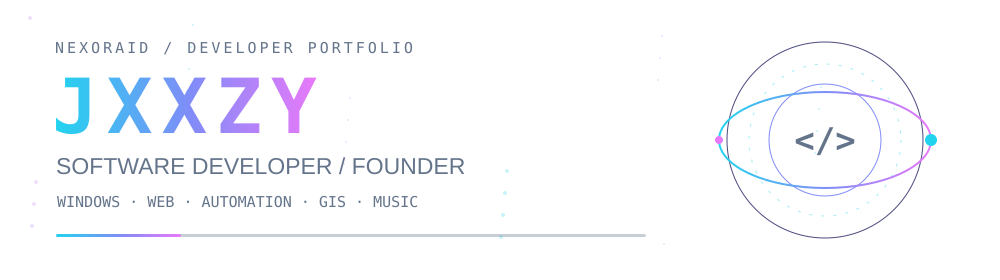
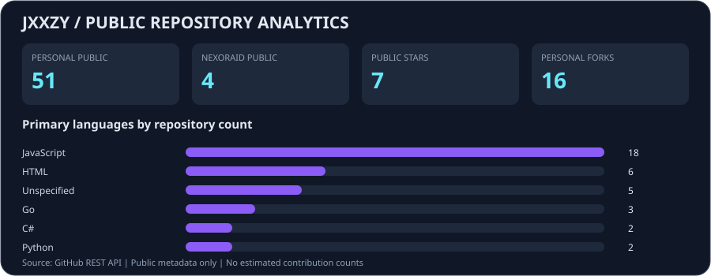
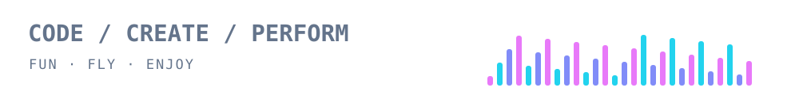

<div align="center">



# Daslan Josua Valentino Siahaan

**Software Developer · NEXORAID Founder · Digital Creator**



[](https://github.com/jxxzy)
[](https://github.com/NEXORAID-ID)
[](https://jxxzy.github.io/)
[](https://github.com/jxxzy)

[About](#about-me) · [Flagship](#flagship-projects) · [Organization](#nexoraid-ecosystem) · [Live catalog](#repository-catalog) · [Stack](#technology-stack) · [Activity](#github-analytics) · [Contact](#connect)

</div>

<p align="center"></p>

## About me

I'm Josua, also known as **JXXZY** and **MR.4NONY** — an Indonesian software developer, applied Informatics Engineering student at Universitas Logistik dan Bisnis Internasional (ULBI), and founder of NEXORAID. I build and explore desktop applications, web platforms, automation, APIs, and tools for real communities. Outside software, I produce music and perform as a DJ under JXXZY.

My Windows optimization work started from a practical problem: many gaming community members and campus users rely on low-spec computers. My goal is to build useful, transparent tools that respect system stability, privacy and user control.

| Direction | What I work on |
| :--- | :--- |
| Desktop engineering | Windows diagnostics, optimization, recovery, packaging and release validation |
| Full-stack & web | Responsive websites, dashboards, digital-service catalogs and backend integration |
| Automation | Discord/WhatsApp bot experiments, API requests, webhooks and AI-assisted workflows |
| GIS & mobile | Geospatial web projects, mapping and collaborative Android CI/CD |
| Creative work | DJ performance, music production, event and artist websites |

> Build with purpose. Test with evidence. Ship responsibly. Keep improving.

## Flagship projects

### HyperBoostX — Windows performance & control center

[](https://github.com/jxxzy/HyperBoostX/stargazers) [](https://github.com/jxxzy/HyperBoostX/commits)

| Track | Scope | Status |
| :--- | :--- | :--- |
| [HyperBoostX V1–V2](https://github.com/jxxzy/HyperBoostX) | Local diagnostics, gaming readiness, preview-first tuning, cleanup, restore workflows and safety guards | Legacy releases; see release notes |
| [HyperBoostX V3](https://github.com/jxxzy/HyperBoostX) | Native Windows desktop app, .NET, privileged-operation safety, rollback, diagnostics and release verification | Unsigned development build; Stable gate not passed |
| [V3 interactive prototype](https://github.com/NEXORAID-ID/hyperboostx-v3-prototype) | Browser UI/UX reference with 73 modules, 14 navigation groups and simulated workflows | Design prototype, not a native optimizer |

[Legacy releases](https://github.com/jxxzy/HyperBoostX/releases) · [V3 source](https://github.com/jxxzy/HyperBoostX) · [Release status](https://github.com/jxxzy/HyperBoostX/blob/main/RELEASE_STATUS.md) · [Try the prototype](https://nexoraid-id.github.io/hyperboostx-v3-prototype/)

**Engineering principles:** no invented FPS or latency results, no unsupported feature claims, explicit previews and approvals, verified changes and recovery paths.

**Research direction:** compare Windows defaults, software tuning, SSD upgrades and RAM upgrades using repeatable measurements on the same PC. Results are not claimed without measured evidence.

### Other featured repositories

| Project | Description | Explore |
| :--- | :--- | :--- |
| **AintSaint** | Static website for SinnersNight and WestSidePeople: talents, mixes, events, media and bookings. | [Source](https://github.com/jxxzy/AintSaint.github.io) |
| **AI-TEJO** | JavaScript AI/bot experiment and automation exploration. | [Source](https://github.com/jxxzy/AI-TEJO) |
| **GIS-GOLANG** | Go-based GIS and backend learning repository. | [Source](https://github.com/jxxzy/GIS-GOLANG) |
| **Geospatial skeleton** | Geospatial web learning project with a published Pages link. | [Source](https://github.com/jxxzy/skeleton-geospasial-gis) · [Demo](https://jxxzy.github.io/skeleton-geospasial-gis/) |
| **WA-BOT-MD** | WhatsApp multi-device bot exploration. | [Source](https://github.com/jxxzy/WA-BOT-MD) |
| **webhook** | Go webhook/backend integration experiment. | [Source](https://github.com/jxxzy/webhook) |

<p align="center"></p>

## NEXORAID ecosystem

NEXORAID is my digital-service and software-development brand. Organization repositories are listed separately from my personal GitHub repositories.

| Public organization repository | Purpose & status |
| :--- | :--- |
| [hyperboostx-v3](https://github.com/NEXORAID-ID/hyperboostx-v3) | Native Windows optimizer/control center; development and verification in progress. |
| [hyperboostx-v3-prototype](https://github.com/NEXORAID-ID/hyperboostx-v3-prototype) | Interactive browser-only specification and UI reference. |
| [nexoraid-id.github.io](https://github.com/NEXORAID-ID/nexoraid-id.github.io) | Static multipage digital-service hub with catalog/search, comparison and Discord ticket links; no live payment backend. |
| [hypehostx](https://github.com/NEXORAID-ID/hypehostx) | Bilingual console homebrew reference portal incorporating credited upstream components; native hardware validation is not claimed. |

[Organization profile](https://github.com/NEXORAID-ID) · [Digital service hub](https://nexoraid-id.github.io/)

**Other product directions:** HYPEBOTX (Discord community automation, ticketing, moderation and AI routing) and provider/payment integrations remain product directions; this profile does not claim a separately verified public source repository or production deployment for them.

## Collaborative & academic work

### TopoSurvey — Android topographic survey

[](https://github.com/SIG-3B/Toposurvey/actions/workflows/ci.yml)
[](https://github.com/SIG-3B/Toposurvey/actions/workflows/codeql.yml)

A collaborative Flutter/Dart application for GPS coordinates, elevation, offline survey storage, OpenStreetMap and GeoJSON export.

**My team role:** GitHub repository workflows / CI/CD: analysis and testing, semantic versioning, auto-tagging, APK build and release automation, checksums and documentation. This is a group project; credit belongs to all contributors.

[Repository](https://github.com/SIG-3B/Toposurvey) · [CI/CD documentation](https://github.com/SIG-3B/Toposurvey/blob/main/docs/CI-CD.md) · [Releases](https://github.com/SIG-3B/Toposurvey/releases)

<p align="center"></p>

## Repository catalog

[](https://github.com/jxxzy/jxxzy/actions/workflows/update-profile.yml) · [Run history](https://github.com/jxxzy/jxxzy/actions/workflows/update-profile.yml) · [Historical catalog](#historical-repository-catalog)

<!-- AUTO:PUBLIC-REPOSITORIES:START -->
| Personal public | Personal non-fork | Personal forks | NEXORAID public |
| :---: | :---: | :---: | :---: |
| **51** | **35** | **16** | **4** |

Public metadata from the GitHub REST API. Non-fork does not imply original authorship.

**Public repository stars:** 6 personal · 1 NEXORAID (including forks).

### Primary languages by repository count

| Language | Public repositories |
| :--- | ---: |
| JavaScript | 18 |
| HTML | 6 |
| Unspecified | 5 |
| Go | 3 |
| C\# | 2 |
| Python | 2 |

Counts public non-fork, non-archived repositories, excluding this profile. Not a measure of skill or lines of code.

### Recently pushed public projects

| Repository | Language | Last push (UTC) | Stars |
| :--- | :--- | :--- | ---: |
| [nexoraid-id.github.io](https://github.com/NEXORAID-ID/nexoraid-id.github.io) | JavaScript | 2026-11-27 | 0 |
| [HyperBoostX](https://github.com/jxxzy/HyperBoostX) | C\# | 2026-11-27 | 1 |
| [netpro-2026](https://github.com/jxxzy/netpro-2026) | Python | 2026-11-26 | 0 |
| [proposal-proyek3](https://github.com/jxxzy/proposal-proyek3) | CSS | 2026-11-20 | 0 |
| [gcfbackend](https://github.com/jxxzy/gcfbackend) | Go | 2026-11-20 | 0 |
| [GIS-CHAPTER-5](https://github.com/jxxzy/GIS-CHAPTER-5) | JavaScript | 2026-11-19 | 0 |
| [chapter1](https://github.com/jxxzy/chapter1) | JavaScript | 2026-11-19 | 0 |
| [open-layer](https://github.com/jxxzy/open-layer) | JavaScript | 2026-11-19 | 0 |

<details>
<summary><b>Personal repositories (51)</b></summary>

| Repository | Language | Type | Stars | Last push (UTC) |
| :--- | :--- | :--- | ---: | :--- |
| [69SPEEDGACOR.github.io](https://github.com/jxxzy/69SPEEDGACOR.github.io) | HTML | Non-fork | 0 | 2024-04-08 |
| [activate-sensorcore](https://github.com/jxxzy/activate-sensorcore) | — | Fork | 0 | 2014-11-27 |
| [AI](https://github.com/jxxzy/AI) | — | Fork | 0 | 2024-01-19 |
| [AI-TEJO](https://github.com/jxxzy/AI-TEJO) | JavaScript | Non-fork | 0 | 2024-03-05 |
| [AintSaint.github.io](https://github.com/jxxzy/AintSaint.github.io) | HTML | Non-fork | 0 | 2026-07-04 |
| [aistore](https://github.com/jxxzy/aistore) | — | Fork | 0 | 2024-02-19 |
| [algoritima1](https://github.com/jxxzy/algoritima1) | JavaScript | Non-fork | 1 | 2026-11-19 |
| [Alice3](https://github.com/jxxzy/Alice3) | — | Non-fork | 0 | 2024-10-31 |
| [bengkelckmrt](https://github.com/jxxzy/bengkelckmrt) | JavaScript | Non-fork | 0 | 2024-11-12 |
| [Bot-Js](https://github.com/jxxzy/Bot-Js) | HTML | Non-fork | 0 | 2023-01-17 |
| [Chapter04](https://github.com/jxxzy/Chapter04) | JavaScript | Non-fork | 0 | 2026-11-19 |
| [chapter1](https://github.com/jxxzy/chapter1) | JavaScript | Non-fork | 0 | 2026-11-19 |
| [CHAT](https://github.com/jxxzy/CHAT) | — | Fork | 0 | 2024-02-19 |
| [cl-iteung-bot-main](https://github.com/jxxzy/cl-iteung-bot-main) | JavaScript | Non-fork | 0 | 2023-01-17 |
| [cyberoren](https://github.com/jxxzy/cyberoren) | JavaScript | Non-fork | 0 | 2022-06-30 |
| [elainav6](https://github.com/jxxzy/elainav6) | — | Fork | 0 | 2022-11-29 |
| [gcfbackend](https://github.com/jxxzy/gcfbackend) | Go | Non-fork | 0 | 2026-11-20 |
| [GETPOST](https://github.com/jxxzy/GETPOST) | JavaScript | Non-fork | 0 | 2026-11-19 |
| [GIS-CHAPTER-3](https://github.com/jxxzy/GIS-CHAPTER-3) | JavaScript | Non-fork | 0 | 2024-02-07 |
| [GIS-CHAPTER-5](https://github.com/jxxzy/GIS-CHAPTER-5) | JavaScript | Non-fork | 0 | 2026-11-19 |
| [GIS-CHAPTER-9](https://github.com/jxxzy/GIS-CHAPTER-9) | — | Non-fork | 0 | 2023-12-01 |
| [GIS-GEO-CHAPTER6](https://github.com/jxxzy/GIS-GEO-CHAPTER6) | — | Non-fork | 0 | 2023-11-03 |
| [GIS-GOLANG](https://github.com/jxxzy/GIS-GOLANG) | Go | Non-fork | 0 | 2024-02-19 |
| [gis7](https://github.com/jxxzy/gis7) | — | Non-fork | 0 | 2023-11-10 |
| [go-ethereum](https://github.com/jxxzy/go-ethereum) | — | Fork | 0 | 2024-02-20 |
| [HyperBoostX](https://github.com/jxxzy/HyperBoostX) | C\# | Non-fork | 1 | 2026-11-27 |
| [jsshn12](https://github.com/jxxzy/jsshn12) | — | Non-fork | 0 | 2022-06-30 |
| [jxxzy](https://github.com/jxxzy/jxxzy) | Python | Non-fork | 1 | — |
| [Jxxzy.github.io](https://github.com/jxxzy/Jxxzy.github.io) | HTML | Non-fork | 1 | 2026-11-19 |
| [linux](https://github.com/jxxzy/linux) | — | Fork | 0 | 2024-02-19 |
| [minio](https://github.com/jxxzy/minio) | — | Fork | 0 | 2024-02-20 |
| [netpro-2026](https://github.com/jxxzy/netpro-2026) | Python | Non-fork | 0 | 2026-11-26 |
| [niia](https://github.com/jxxzy/niia) | Python | Fork | 0 | 2026-11-20 |
| [nlp](https://github.com/jxxzy/nlp) | Python | Fork | 0 | 2026-11-19 |
| [open-layer](https://github.com/jxxzy/open-layer) | JavaScript | Non-fork | 0 | 2026-11-19 |
| [pbo-ll](https://github.com/jxxzy/pbo-ll) | JavaScript | Non-fork | 1 | 2026-11-19 |
| [PowerPlatformConnectors](https://github.com/jxxzy/PowerPlatformConnectors) | — | Fork | 0 | 2024-02-20 |
| [proposal-proyek3](https://github.com/jxxzy/proposal-proyek3) | CSS | Non-fork | 0 | 2026-11-20 |
| [react-native-test-app](https://github.com/jxxzy/react-native-test-app) | — | Fork | 0 | 2024-02-20 |
| [semantic-kernel](https://github.com/jxxzy/semantic-kernel) | — | Fork | 0 | 2024-02-20 |
| [skeleton-geospasial-gis](https://github.com/jxxzy/skeleton-geospasial-gis) | JavaScript | Non-fork | 1 | 2026-11-19 |
| [UASALGO](https://github.com/jxxzy/UASALGO) | Java | Non-fork | 0 | 2022-08-09 |
| [WA-BOT](https://github.com/jxxzy/WA-BOT) | JavaScript | Non-fork | 0 | 2023-11-14 |
| [WA-BOT-MD](https://github.com/jxxzy/WA-BOT-MD) | JavaScript | Non-fork | 0 | 2023-11-14 |
| [WA-CYBEROREN](https://github.com/jxxzy/WA-CYBEROREN) | — | Fork | 0 | 2023-11-06 |
| [wajxxzybot-main](https://github.com/jxxzy/wajxxzybot-main) | JavaScript | Non-fork | 0 | 2023-01-17 |
| [webhook](https://github.com/jxxzy/webhook) | Go | Non-fork | 0 | 2023-11-17 |
| [webhooks](https://github.com/jxxzy/webhooks) | PHP | Fork | 0 | 2023-11-17 |
| [Whatsapp-BotChat-master](https://github.com/jxxzy/Whatsapp-BotChat-master) | Python | Non-fork | 0 | 2023-01-17 |
| [whatsapp-web.js-main](https://github.com/jxxzy/whatsapp-web.js-main) | JavaScript | Non-fork | 0 | 2023-01-17 |
| [ws](https://github.com/jxxzy/ws) | HTML | Fork | 0 | 2023-02-20 |

</details>

<details>
<summary><b>NEXORAID repositories (4)</b></summary>

| Repository | Language | Type | Stars | Last push (UTC) |
| :--- | :--- | :--- | ---: | :--- |
| [hypehostx](https://github.com/NEXORAID-ID/hypehostx) | HTML | Non-fork | 0 | 2026-11-15 |
| [hyperboostx-v3](https://github.com/NEXORAID-ID/hyperboostx-v3) | C\# | Non-fork | 0 | 2026-11-16 |
| [hyperboostx-v3-prototype](https://github.com/NEXORAID-ID/hyperboostx-v3-prototype) | HTML | Non-fork | 1 | 2026-11-17 |
| [nexoraid-id.github.io](https://github.com/NEXORAID-ID/nexoraid-id.github.io) | JavaScript | Non-fork | 0 | 2026-11-27 |

</details>

<sub>Scheduled refresh every six hours (GitHub may delay runs); commits are made only when the displayed data changes. This portfolio repository's push date is omitted to prevent self-triggered changes.</sub>
<!-- AUTO:PUBLIC-REPOSITORIES:END -->

The curated catalog below is retained as a historical snapshot. This separate index is maintained by [GitHub Actions](https://github.com/jxxzy/jxxzy/actions/workflows/update-profile.yml) using public repository metadata only. Forks retain upstream attribution; organization projects remain separate.

## Historical repository catalog

<details>
<summary><b>View original curated snapshot (19 November 2026)</b></summary>

<div align="center">

| Personal public repositories | Non-fork repositories | GitHub-marked forks | NEXORAID public repositories |
| :---: | :---: | :---: | :---: |
| **50** | **34** | **16** | **4** |

<sub>Snapshot: 19 November 2026. Includes this profile repository; organization and team work are not included in the personal total.</sub>

</div>

This historical catalog preserves the 19 November 2026 snapshot; use the live index above for current counts and repositories. The 50 public personal repositories recorded at that time are listed below. Non-fork is GitHub metadata, **not** proof of original authorship; imported code and learning projects may contain upstream material. Languages reflect GitHub's primary language where available, with Markdown/SVG noted for this profile. A dash indicates no reported primary language.

<details>
<summary><b>Flagship & product projects (4)</b></summary>

| Repository | Main language | Scope |
| :--- | :--- | :--- |
| [HyperBoostX](https://github.com/jxxzy/HyperBoostX) | C# | Windows control center; preview-first optimization, diagnostics, gaming readiness and recovery. |
| [AI-TEJO](https://github.com/jxxzy/AI-TEJO) | JavaScript | AI and bot automation experiment. |
| [bengkelckmrt](https://github.com/jxxzy/bengkelckmrt) | JavaScript | Workshop/business web project. |
| [AintSaint.github.io](https://github.com/jxxzy/AintSaint.github.io) | HTML | Event-organizer and DJ talent website; music, events, media and booking. |

</details>

<details>
<summary><b>Web, identity & personal branding (4)</b></summary>

| Repository | Main language | Scope |
| :--- | :--- | :--- |
| [Jxxzy.github.io](https://github.com/jxxzy/Jxxzy.github.io) | HTML | Personal GitHub Pages website. |
| [69SPEEDGACOR.github.io](https://github.com/jxxzy/69SPEEDGACOR.github.io) | HTML | Static website project. |
| [mr.4nony](https://github.com/jxxzy/mr.4nony) | Markdown / SVG | Earlier portfolio repository name at the time of the snapshot. |
| [jsshn12](https://github.com/jxxzy/jsshn12) | — | Legacy GitHub profile configuration. |

</details>

<details>
<summary><b>Bots & messaging labs (8)</b></summary>

| Repository | Main language | Scope |
| :--- | :--- | :--- |
| [WA-BOT](https://github.com/jxxzy/WA-BOT) | JavaScript | WhatsApp bot experiment. |
| [WA-BOT-MD](https://github.com/jxxzy/WA-BOT-MD) | JavaScript | Multi-device WhatsApp bot exploration. |
| [Bot-Js](https://github.com/jxxzy/Bot-Js) | HTML | Bot-related web repository. |
| [Whatsapp-BotChat-master](https://github.com/jxxzy/Whatsapp-BotChat-master) | Python | WhatsApp chatbot repository. |
| [cl-iteung-bot-main](https://github.com/jxxzy/cl-iteung-bot-main) | JavaScript | Messaging bot codebase. |
| [wajxxzybot-main](https://github.com/jxxzy/wajxxzybot-main) | JavaScript | Personal WhatsApp bot repository. |
| [whatsapp-web.js-main](https://github.com/jxxzy/whatsapp-web.js-main) | JavaScript | WhatsApp Web library/codebase exploration. |
| [cyberoren](https://github.com/jxxzy/cyberoren) | JavaScript | Early JavaScript repository. |

</details>

<details>
<summary><b>GIS & geospatial engineering (8)</b></summary>

| Repository | Main language | Scope |
| :--- | :--- | :--- |
| [GIS-GOLANG](https://github.com/jxxzy/GIS-GOLANG) | Go | GIS and Go backend exploration. |
| [skeleton-geospasial-gis](https://github.com/jxxzy/skeleton-geospasial-gis) | JavaScript | Geospatial skeleton web project. |
| [GIS-CHAPTER-3](https://github.com/jxxzy/GIS-CHAPTER-3) | JavaScript | GIS chapter learning repository. |
| [GIS-CHAPTER-5](https://github.com/jxxzy/GIS-CHAPTER-5) | JavaScript | GIS chapter learning repository. |
| [GIS-GEO-CHAPTER6](https://github.com/jxxzy/GIS-GEO-CHAPTER6) | — | Geospatial chapter repository. |
| [gis7](https://github.com/jxxzy/gis7) | — | GIS chapter 7 repository. |
| [GIS-CHAPTER-9](https://github.com/jxxzy/GIS-CHAPTER-9) | — | GIS chapter learning repository. |
| [open-layer](https://github.com/jxxzy/open-layer) | JavaScript | Web mapping / OpenLayers exploration. |

</details>

<details>
<summary><b>Backend & integrations (3)</b></summary>

| Repository | Main language | Scope |
| :--- | :--- | :--- |
| [GETPOST](https://github.com/jxxzy/GETPOST) | JavaScript | GET/POST request-handling assignment. |
| [gcfbackend](https://github.com/jxxzy/gcfbackend) | Go | Cloud-function backend exploration. |
| [webhook](https://github.com/jxxzy/webhook) | Go | Webhook integration repository. |

</details>

<details>
<summary><b>Academic & foundational labs (7)</b></summary>

| Repository | Main language | Scope |
| :--- | :--- | :--- |
| [UASALGO](https://github.com/jxxzy/UASALGO) | Java | Algorithm assessment repository. |
| [algoritima1](https://github.com/jxxzy/algoritima1) | JavaScript | Algorithm fundamentals coursework. |
| [pbo-ll](https://github.com/jxxzy/pbo-ll) | CSS | Coursework repository. |
| [proposal-proyek3](https://github.com/jxxzy/proposal-proyek3) | CSS | Project proposal repository. |
| [chapter1](https://github.com/jxxzy/chapter1) | JavaScript | Chapter-based learning repository. |
| [Chapter04](https://github.com/jxxzy/Chapter04) | JavaScript | Chapter-based learning repository. |
| [Alice3](https://github.com/jxxzy/Alice3) | — | Alice3-related repository; scope not documented. |

</details>

<details>
<summary><b>Open-source research & GitHub-marked forks (16)</b></summary>

| Repository | Research / reference area |
| :--- | :--- |
| [AI](https://github.com/jxxzy/AI) | AI ecosystem research |
| [nlp](https://github.com/jxxzy/nlp) | Natural-language processing research |
| [semantic-kernel](https://github.com/jxxzy/semantic-kernel) | AI orchestration research |
| [PowerPlatformConnectors](https://github.com/jxxzy/PowerPlatformConnectors) | Connector and integration architecture |
| [minio](https://github.com/jxxzy/minio) | Object storage architecture |
| [aistore](https://github.com/jxxzy/aistore) | AI storage infrastructure |
| [go-ethereum](https://github.com/jxxzy/go-ethereum) | Ethereum protocol implementation |
| [linux](https://github.com/jxxzy/linux) | Kernel and operating-system source |
| [CHAT](https://github.com/jxxzy/CHAT) | Tinode messaging architecture |
| [react-native-test-app](https://github.com/jxxzy/react-native-test-app) | Mobile testing infrastructure |
| [activate-sensorcore](https://github.com/jxxzy/activate-sensorcore) | Sensor-related reference project |
| [ws](https://github.com/jxxzy/ws) | Go Fiber framework reference |
| [webhooks](https://github.com/jxxzy/webhooks) | Webhook package research |
| [WA-CYBEROREN](https://github.com/jxxzy/WA-CYBEROREN) | WhatsApp bot reference |
| [elainav6](https://github.com/jxxzy/elainav6) | Bot/API codebase reference |
| [niia](https://github.com/jxxzy/niia) | Personal-interest fork |

These projects retain their upstream identities and licenses. Listing a fork does not imply authorship, maintainership or affiliation with its upstream organization.

</details>

[Browse all public repositories on GitHub →](https://github.com/jxxzy?tab=repositories)

</details>

## Technology stack

Technologies used or explored across personal, team and research projects. This is a working toolkit, not a claim of expert-level mastery in every technology.

<div align="center">


</div>

| Area | Tools & concepts |
| :--- | :--- |
| Desktop | C#, .NET, Windows, PowerShell, installer and portable packaging |
| Web | HTML, CSS, JavaScript, TypeScript, React, Node.js, PHP, Go; framework exploration |
| Mobile & GIS | Flutter, Dart, SQLite, OpenStreetMap, GeoJSON, QGIS, OpenLayers |
| Automation & integrations | Discord.js, WhatsApp bot tooling, REST, webhooks, OAuth, Postman |
| Delivery & quality | Git, GitHub Actions, SemVer, checksums, test automation, CodeQL |
| Research | Semantic Kernel, AI workflows, Linux, object storage and system architecture |

### Engineering workflow

```text
Problem -> Requirements -> Prototype -> Implementation
        -> Automated tests -> Safety / security review
        -> Package -> Release -> Feedback -> Iterate
```

Projects differ in maturity. A prototype is not a finished product; a passing unit test is not proof that every requirement is verified.

<p align="center"></p>

## GitHub analytics

<div align="center">



</div>

<sub>Local analytics refresh with the repository catalog and work without third-party image services. Languages count public non-fork, non-archived repositories (excluding this profile), not lines of code or skill levels.</sub>

<details open>
<summary><b>Additional live contribution cards (external providers)</b></summary>

<div align="center">

<a href="https://github.com/jxxzy"></a>
<a href="https://github.com/jxxzy"></a>


[](https://github.com/jxxzy?tab=followers)
[](https://github.com/jxxzy?tab=repositories)
[](https://github.com/jxxzy)

</div>

</details>

Contribution cards, skill icons and Shields badges are refreshed from their original providers and stored locally when valid. If a provider fails, the last verified image is retained; if no valid snapshot exists, an explicitly labeled unavailable card is shown. The profile-view counter and native GitHub workflow badges remain live. [Provider health](assets/provider-cache/status.json). Language distribution is not a proficiency score. The API-generated repository totals and recent activity in the [live catalog](#repository-catalog) remain available independently of these image providers. The native [GitHub contribution history](https://github.com/jxxzy) and [repositories](https://github.com/jxxzy?tab=repositories) remain the source of record.

## Current focus

- HyperBoostX V3: real Windows functionality, safety, feature traceability and stable-release evidence.
- NEXORAID: useful community tools and digital-service platforms.
- Automation: bot systems, API integration, and reliable delivery workflows.
- Applied research: measurable PC performance and geospatial software.
- Creative engineering: bridging software, community, music and live events.

## Connect

<div align="center">



[](https://github.com/jxxzy)
[](https://instagram.com/jxxzyshn)
[](https://www.tiktok.com/@mr.4nony)
[](https://www.youtube.com/@jxxzymix)
[](https://discord.gg/sBUA95rnFN)

Open to discussing software projects, collaboration, automation and creative work.

**JXXZY — FUN, FLY, ENJOY.**

</div>

<p align="center"></p>

<sub>Profile visuals are local animated SVG assets (decorative, not live system telemetry). External cards and badges are optional presentation layers. See each project's own README, release status and license for authoritative details.</sub>
